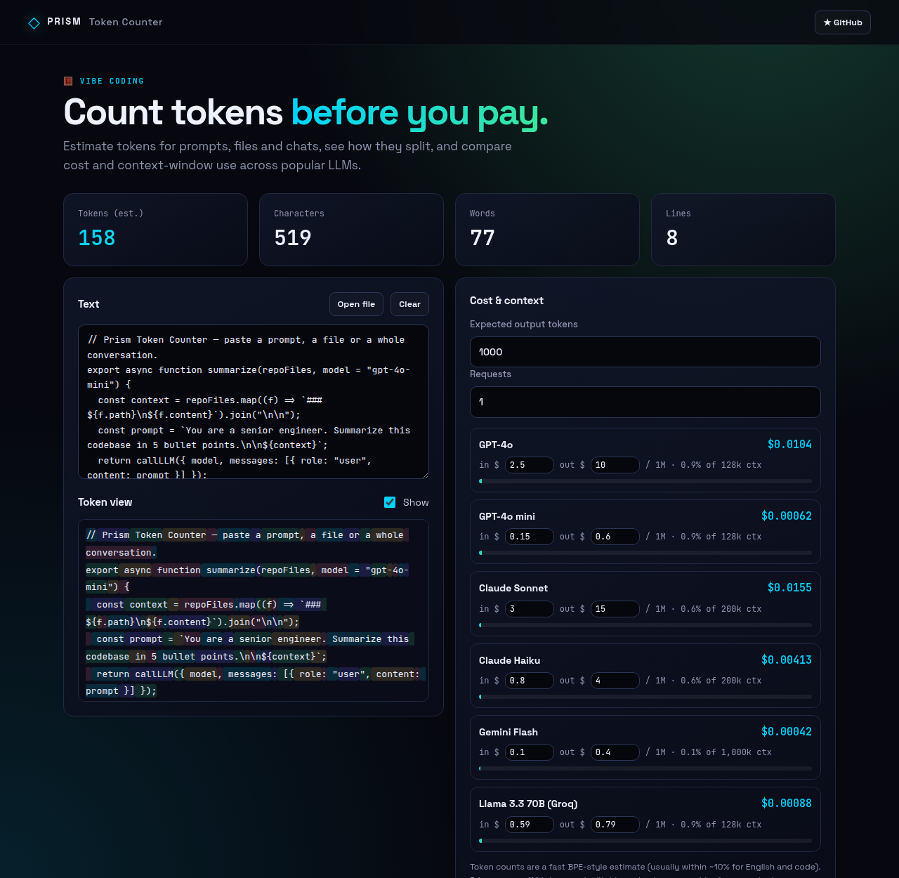
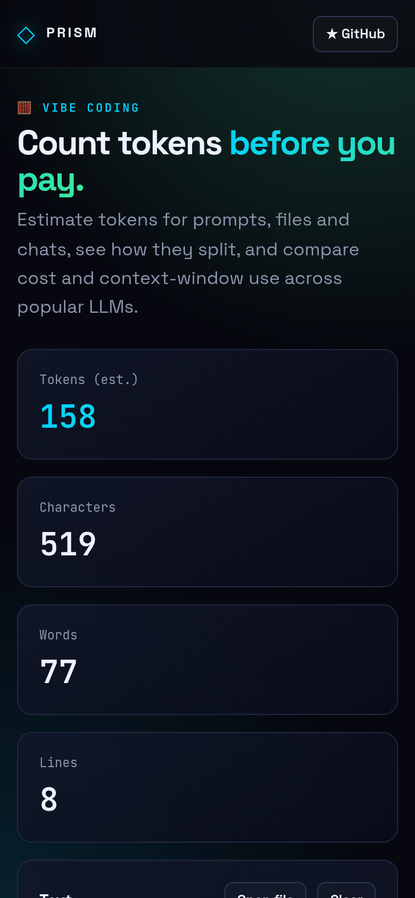

<!-- ═════════════ HEADER ═════════════ -->
<p align="center">
  
</p>

<p align="center">
  
</p>

<p align="center">
  <a href="https://github.com/krishyaa06/prism-token-counter/actions/workflows/ci.yml"></a>
  <a href="https://krishyaa06.github.io/prism-token-counter/"></a>
  
  
  <a href="LICENSE"></a>
</p>

<p align="center">
  
</p>


## ⚡ Overview

**Prism Token Counter** answers the questions you have before sending a big prompt: how many tokens is this, what will it cost, and will it fit? It uses a fast GPT-style pre-tokenizer with BPE-like heuristics (no downloads, instant on large files), colours each token chunk so you can see how text splits, and estimates cost and context use for several popular models. Prices are editable and remembered, since providers change them.

## ✨ Features

- **Instant token estimate** + characters, words, lines
- **Token view** — colour-coded chunks with per-chunk counts on hover
- **Cost per request** across GPT-4o, Claude, Gemini, Llama (Groq) — multiply by request count
- **Context-window meters** that turn red when you overflow
- **Editable prices** saved locally
- Open any text file; nothing is uploaded

## 📸 Screenshots

<table>
  <tr>
    <td width="68%"></td>
    <td width="32%"></td>
  </tr>
</table>

## 🚀 Quick Start

**Use it online:** [https://krishyaa06.github.io/prism-token-counter/](https://krishyaa06.github.io/prism-token-counter/)

**Run locally:**

```bash
git clone https://github.com/krishyaa06/prism-token-counter.git
cd prism-token-counter
# open index.html in your browser, or serve it:
npx serve .
```

## 🛠️ Usage

Paste text or open a file, set the expected output tokens and number of requests, and read the cost and context meters. Click a price to edit it for your provider.

> Counts are estimates (typically within ~10% for English and code). For exact billing use your provider's tokenizer.

## 📁 Project Structure

```
prism-token-counter/
├── assets/
│   ├── logo.png
│   └── logo.svg
├── css/
│   ├── app.css
│   └── prism.css
├── js/
│   ├── app.js   # UI and token view
│   ├── core.js   # pre-tokenizer, estimator, cost maths — tested in Node
│   └── prism.js
├── test/
│   └── core.test.js
├── .gitignore
├── LICENSE
├── index.html
└── package.json
```

## 🧪 Tests

```bash
npm test
```

Tests use the built-in `node:test` runner, so there is nothing to install. CI runs them on Node 20 and 22.

## 🤝 Contributing

1. Fork the repo and create a branch: `git checkout -b feature/my-idea`
2. Make your change and add a test in `test/`
3. Run `npm test` and open a Pull Request

## 🔷 Part of Prism Protocol

Prism Token Counter is one of the open-source tools built by [Prism Protocol](https://dc.gg/prismprotocol), a tech community where young builders learn, ship and compete together.

## 👤 Author

<table>
  <tr>
    <td align="center">
      <a href="https://github.com/krishyaa06"><br><b>Soumya Bhandare</b></a><br>
      <sub>Founder @ Prism Protocol</sub>
    </td>
    <td>
      <a href="https://dc.gg/prismprotocol"></a><br>
      <a href="https://instagram.com/prism_protocol_"></a><br>
      <a href="https://x.com/krishyaa06"></a>
    </td>
  </tr>
</table>

## 📄 License

Released under the [MIT License](LICENSE).

<p align="center">
  <b>If you like this project, consider giving it a ⭐</b><br>
  <sub>"Build. Create. Compete." · Made with ⚡ by Prism Protocol</sub>
</p>


